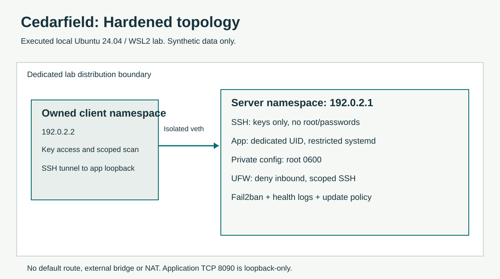

# Cedarfield: Linux application-server hardening & operations

**Shemar Marks · Synthetic portfolio engagement · Executed 2026-10-05 · Ubuntu 24.04 on local WSL2**

A working service-job register had weak host controls. This engagement assessed the baseline, reduced unnecessary exposure and privilege, verified the application, exercised rollback and left a maintenance path. Cedarfield is a fictional small business. This is real local lab execution, with synthetic data, and no paid-client or production claim.

## Observed outcome

| Control / result | Before | Observed after |
| --- | --- | --- |
| Required workload | Health `ok`, three synthetic jobs | Health `ok`, original three jobs preserved |
| Application identity | Root (no service User/Group) | Dedicated `cedarfield` user, UID 999, no effective capabilities, NoNewPrivs 1 |
| Network exposure from owned peer | TCP 22222 and 9099 open | Only SSH 22222 open among tested ports; unnecessary service disabled |
| Remote administration policy | Password SSH enabled, root SSH permitted in effective configuration | Public-key authentication required, password and root SSH disabled; intended key access and tunnel verified |
| Runtime configuration | `0644 root:root` | `0600 root:root`; unrelated `nobody` identity cannot read it |
| Service restrictions | NoNewPrivileges/PrivateTmp off, ProtectSystem off | NoNewPrivileges and PrivateTmp on, ProtectSystem strict, ProtectHome on, controlled writable state |
| Firewall | Inactive | Default-deny incoming, only owned client permitted to SSH; unallowed live probe port filtered |
| Authentication detection | No active Fail2ban protection | Four safe failed attempts recorded, one peer ban installed; unban and legitimate access verified |
| Operations | Update timers inactive, minimal procedure | Security-update policy and timers configured, health log observed, local backup integrity `ok` |
| Change safety | No staged handover | Check mode, preserved config backup, repeat application, rollback health check and final re-hardening verified |

[Case study](docs/CASE-STUDY.md) · [Evidence and limitations](evidence/README.md) · [Acceptance criteria](verification/acceptance-criteria.md) · [Runbook](docs/RUNBOOK.md) · [Presentation](presentation/Cedarfield-Linux-Operations.pptx)

## Architecture and isolation

The free lab uses a new Ubuntu WSL2 distribution and two isolated Linux network namespaces. The server and owned client connect through a veth pair using documentation-only TEST-NET-1 addresses. Neither namespace has a default route, bridge or NAT. The app binds to server loopback and the administrator reaches it through SSH forwarding. Firewall and Fail2ban run in the server namespace, avoiding changes to existing WSL or home-network firewall rules. This was not executed on Proxmox and does not prove a Proxmox deployment.

## Engineering record

- [Baseline topology](docs/diagrams/baseline.svg), [architecture](docs/ARCHITECTURE.md)
- [Business risk register](docs/RISK-ASSESSMENT.md), [decisions and tradeoffs](docs/DECISIONS.md)
- [Implementation](docs/IMPLEMENTATION.md), [baseline findings](baseline/expected-findings.md)
- [Safe maintenance and recurring care](docs/MAINTENANCE.md)
- [Application and configuration CI](https://github.com/Shemarhn/cedarfield-linux-operations/actions)

## Reuse

Read the implementation and runbook before execution. Mutating scripts require `/etc/cedarfield-lab`, root and the isolated server namespace. `harden.sh` defaults to `--check`; `--apply` also requires a recorded successful administrator key login. They target this synthetic lab and are not a drop-in production hardening tool. Production SSH settings and firewall allowances require the actual access requirements and a verified recovery console.

## Limits

One local server, a WSL2-specific network design, shared application write identity and local backups remain. Backups on the same virtual disk do not protect against disk loss. Security-update configuration and active timers do not prove a future unattended patch cycle or reboot maintenance. Health logging provides local detection, not remote notification or 24/7 monitoring. No penetration test, production SLA, availability result, recovery duration or cost-saving measurement is claimed. All tooling and local resources used for this project are free.

For client work, the relevant deliverable is a verified change record, reduced unnecessary access, functioning workload, rollback procedure and usable maintenance handover.
