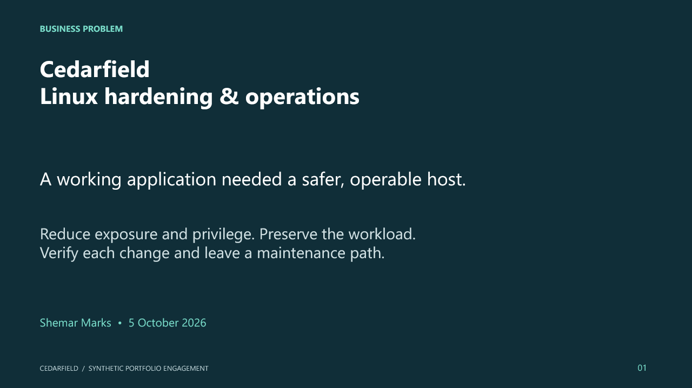

# Cedarfield case-study presentation

[Download the editable 15-slide presentation](Cedarfield-Linux-Operations.pptx).

The presentation covers the business problem, isolated baseline, risk register, decisions, implementation, observed network/privilege/access changes, operations, verification, rollback, residual limits and proposed ongoing care. Figures use the actual project evidence. All business names and customer aliases are synthetic. No Proxmox or production execution is claimed.

Sources for each evidence slide appear in speaker notes and in the [evidence index](../evidence/README.md).
